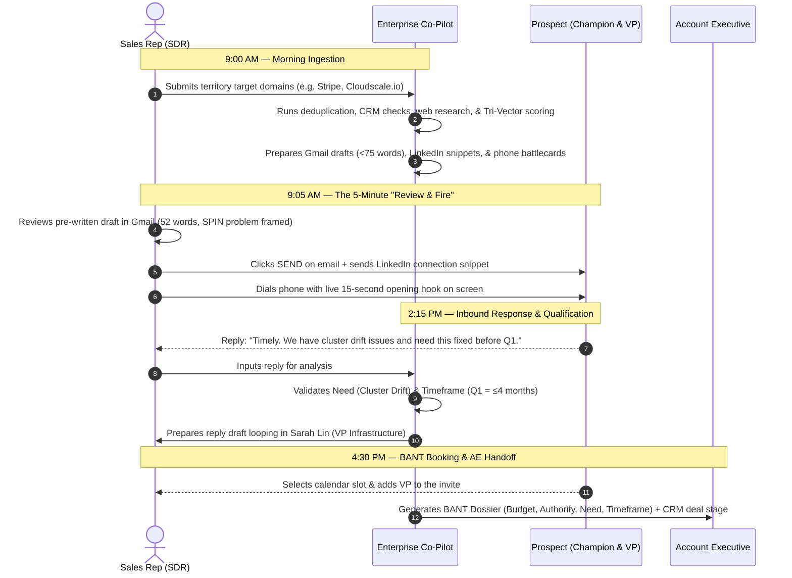

# 🚀 Enterprise SDR Co-Pilot: Platform Overview & Client Brief

> **The Autonomous Account-Based Prospecting Engine (ABSD Operating System)**  
> *Transforming standard sales development reps into top-1% consultative enterprise pipeline generators.*

---

## Executive Summary

Modern B2B enterprise sales ($10,000 to $150,000+ ACV) cannot be won with high-volume email blasts and generic outreach. Today's buyers are protected by enterprise spam filters and an average of **6.8 decision-makers** per buying committee.

According to *The Bridge Group*, the average enterprise SDR costs **$120,000 to $140,000/year**, takes **3 to 4 months to ramp**, and spends **over 60% of their working hours on manual administrative tasks** (scrolling LinkedIn, researching tech stacks, and writing unread emails). Consequently, **40% of SDRs miss quota**, while Account Executives (AEs) waste over half their calendars on unqualified "tire-kicker" demos.

The **Enterprise SDR Co-Pilot** is an autonomous Account-Based Sales Development engine. It acts as an **AI "Iron Man Suit"** for your sales reps—automating deep technical research, mapping complete buying committees, generating role-specific consultative messages, and enforcing strict BANT qualification before any meeting touches an Account Executive's calendar.

---

## 1. What You Are Getting (In Plain English)

This is not another contact database (like ZoomInfo or Apollo) and it is not an automated spam bot. 

It is an **autonomous intelligence and orchestration layer** that integrates with your existing CRM, Gmail/Outlook, and sales tools:

```
┌─────────────────────────────────────────────────────────────────────────────┐
│                      THE ENTERPRISE SDR CO-PILOT STACK                      │
├─────────────────────────────────────────────────────────────────────────────┤
│                                                                             │
│  1. AUTONOMOUS ACCOUNT INTELLIGENCE                                         │
│     Scans target company websites, job postings (Greenhouse/Lever), cloud   │
│     telemetry, and SEC filings to extract verified operational pain points  │
│     in seconds, not hours.                                                  │
│                                                                             │
│  2. 6.8-PERSON BUYING COMMITTEE MAPPING                                     │
│     Identifies and coordinates outreach across the entire decision unit:    │
│     Champions (Engineers/Managers), Economic Buyers (VPs/C-Level), and      │
│     Technical Evaluators (InfoSec/CISO).                                    │
│                                                                             │
│  3. PRE-COMPUTED SPIN MESSAGING ENGINE                                      │
│     Generates mobile-optimized email drafts strictly under 75 words using   │
│     Neil Rackham's SPIN Selling and Chris Voss's tactical empathy. Zero     │
│     lazy discovery questions; 100% loss-aversion problem framing.           │
│                                                                             │
│  4. MULTI-CHANNEL PHONE BATTLECARDS                                         │
│     Arms reps with 15-second cold call hooks, objection-handling matrices,  │
│     and 20-second voicemail scripts before they dial.                       │
│                                                                             │
│  5. BANT CALENDAR GATEKEEPER                                                │
│     Protects AE calendars by blocking unqualified meetings. A meeting is    │
│     only scheduled when Budget, Authority, Need, and a ≤6-month Timeframe   │
│     are verified with an accompanying SQA Handoff Dossier.                  │
│                                                                             │
│  6. TEMPORAL CALENDAR & HOLIDAY PRECISION                                   │
│     Automatically pauses cadences during regional bank holidays, school     │
│     half-terms, and Q4 retail code freezes, while harvesting Out-Of-Office  │
│     (OOO) replies into new warm executive contacts.                         │
│                                                                             │
└─────────────────────────────────────────────────────────────────────────────┘
```

---

## 2. Before vs. After: The Rep's Day

| Stage | Without Co-Pilot (Traditional SDR) | With Co-Pilot (Supercharged Rep) |
| :--- | :--- | :--- |
| **Account Research** | Spends 45 mins per account guessing tech stack and open pain points. | **Takes 30 seconds.** Co-pilot scans telemetry and delivers verified pain. |
| **Email Writing** | Stares at a blank screen; copies templates with a 1.2% reply rate. | **Pre-written in drafts (<75 words).** Rep reviews, approves, and sends. |
| **Cold Calling** | Terrified to dial; stumbles over objections and gets hung up on. | **Reads live battlecard:** 15-sec hook, voicemail, and objection scripts. |
| **Outreach Coordination** | Blasts identical emails to 3 people at the same company (looks like spam). | **Multi-threads:** Champion gets technical angle; VP gets financial ROI. |
| **Holiday Mistakes** | Emails UK executives during May Bank Holiday (damages reputation). | **Auto-paused.** System detects regional holidays and reschedules touches. |
| **AE Calendar Quality** | Books coffee chats with people who have no budget; AEs get angry. | **100% BANT-Verified:** AE receives an executive briefing dossier per meeting. |
| **Daily Output** | 8 to 10 accounts worked per day. | **35 to 50 accounts worked per day (4x to 5x increase).** |

---

## 3. Real-World Walkthrough: A Day in the Life

Here is how a sales representative actually interacts with the platform:



---

## 4. Sample Deliverable: The BANT SQA Handoff Dossier

Every time an appointment is booked, your Account Executive receives an executive briefing card directly in their inbox and CRM:

```markdown
### 🎯 Sales Qualified Appointment (SQA) Dossier
* **Target Account:** Cloudscale.io ($35,000 Est. ACV)
* **Confirmed Meeting:** Thursday, Oct 29, 2026 @ 2:00 PM EST
* **Attendees:** Marcus Vance (Lead SRE - Champion) + Sarah Lin (VP Infrastructure - Economic Buyer)

#### BANT Verification Breakdown
* **Budget ($10k+ Floor):** VERIFIED — 140 software engineers on LinkedIn; $22M Series B; enterprise AWS + Datadog footprint confirmed.
* **Authority:** VERIFIED — SRE Champion + VP Infrastructure confirmed on calendar invite.
* **Need:** VERIFIED — Multi-region Kubernetes configuration drift causing SOC 2 audit delays and $14k/mo in unmonitored cross-zone egress charges.
* **Timeframe (≤ 6 Months):** VERIFIED — Hard compelling event: Annual AWS Enterprise Discount Program renewal in Q1 2027 (~4 months).

#### AE Battle Strategy & Landmines
* **Opening Angle:** Reference Marcus's initiative to synchronize cluster policies before the Q1 AWS contract renewal.
* **Commercial Landmine:** Do not pitch automated cluster provisioning (they already built an internal Terraform module); focus strictly on drift remediation.
```

---

## 5. Commercial Impact & ROI for Sales Leadership

For a B2B SaaS organization with a team of 5 SDRs:

```
┌─────────────────────────────────────────────────────────────────────────────┐
│                       ANNUAL ROI & PRODUCTIVITY IMPACT                      │
├─────────────────────────────────────────────────────────────────────────────┤
│                                                                             │
│  • Cost of 5 Human SDRs: $500,000 – $650,000 / year                         │
│  • Account Capacity: Expands from 40 accounts/day to 180+ accounts/day      │
│  • Quota Attainment: Elevates from industry average 60% to 85%+             │
│  • AE Efficiency: Eliminates 54% of wasted AE time on unqualified demos     │
│  • Pipeline Generated: Adds an estimated $1.8M – $3.5M in qualified         │
│    pipeline per year by capturing multi-threaded buying committees.         │
│                                                                             │
└─────────────────────────────────────────────────────────────────────────────┘
```

---

## 6. Security, Compliance & Platform Safety

* **Draft-Only Safety Wall:** The platform **never sends emails autonomously**. Reps maintain 100% human-in-the-loop oversight to review, edit, and click send.
* **Suppression & Opt-Out Priority:** Active CRM opportunities, existing accounts, and global opt-out lists take absolute mechanical precedence.
* **Prompt Injection Sandboxing:** Scraped web content is isolated through an adversarial sanitizer to prevent malicious external prompt injection attacks.
* **Reputation Defense:** Strict 75-word limits, interest-based CTAs, and automated holiday freezes ensure domain reputation and deliverability remain pristine.

---

## 7. How to Get Started

Deployment takes less than **48 hours**:
1. **GTM Configuration:** We ingest your Ideal Customer Profile (ICP), buyer personas, competitor counter-proofs, and minimum deal size into `gtm-config.yaml`.
2. **Tool Integration:** Connect your existing CRM (Salesforce/HubSpot), Gmail/Outlook, and calendar feeds.
3. **Pilot Activation:** Load your top 50 Tier-1 target accounts and experience top-tier consultative pipeline generation on Day 1.
