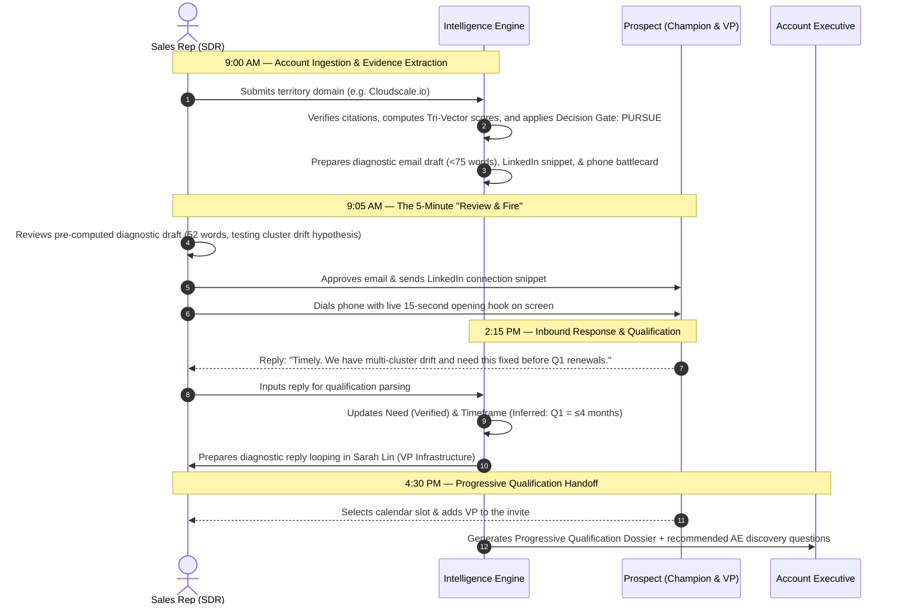

# 🚀 Evidence-Led Account Intelligence & Pipeline Creation Engine

> **Platform Overview & Client Brief**  
> *Transforming sales development into an evidence-backed intelligence discipline that creates defensible enterprise pipeline.*

---

## Executive Summary

Modern enterprise B2B sales ($10,000 to $150,000+ ACV) cannot be won with high-volume spray-and-pray email blasts. Target buyers are protected by enterprise spam filters, strict compliance regimes, and complex, consensus-driven buying groups.

According to *The Bridge Group*, the average enterprise SDR costs **$120,000 to $140,000/year**, takes **3 to 4 months to ramp**, and spends **over 60% of their working hours on manual administrative tasks** (scrolling job boards, guessing tech stacks, and writing generic emails with 1% reply rates). Consequently, **40% of SDRs miss quota**, while Account Executives (AEs) waste over half their calendars on unqualified "tire-kicker" demos.

The **Evidence-Led Account Intelligence & Pipeline Creation Engine** solves this structural failure. Rather than acting as another unconstrained AI email generator, it separates **Account Intelligence** from **Execution**. It audits public telemetry, enforces strict evidence provenance, maps dynamic stakeholder groups, applies uncertainty-aware decision gates, and provides AEs with **Progressive Qualification Dossiers** featuring explicit unknowns and recommended validation questions.

---

## 1. What You Are Getting (In Plain English)

This is not another raw contact database (like ZoomInfo or Apollo) and it is not an automated spam bot. 

It is an **autonomous account intelligence and decision layer** that integrates with your existing CRM, mailbox, and sales workflow:

```
┌─────────────────────────────────────────────────────────────────────────────┐
│             THE EVIDENCE-LED ACCOUNT INTELLIGENCE & PIPELINE ENGINE         │
├─────────────────────────────────────────────────────────────────────────────┤
│                                                                             │
│  1. AUDITED EVIDENCE ENGINE                                                 │
│     Extracts primary-source citations (job postings, SEC filings, telemetry)│
│     with exact verbatim quotes and enforces signal decay half-lives.        │
│                                                                             │
│  2. UNCERTAINTY-AWARE DECISION GATE                                         │
│     Evaluates ICP Fit, Buying Momentum, and Confidence to commit every      │
│     account to: PURSUE, RESEARCH MORE, MONITOR, or DISQUALIFY.              │
│                                                                             │
│  3. DYNAMIC STAKEHOLDER MAPPING                                             │
│     Maps buying groups organically (Champions, Economic Buyers, Technical   │
│     Evaluators) without arbitrary headcounts or invented titles.            │
│                                                                             │
│  4. DIAGNOSTIC PROBLEM HYPOTHESES                                           │
│     Pre-computes mobile-optimized (<75 word) diagnostic drafts framing       │
│     observable trade-offs, accompanied by real-time phone battlecards.      │
│                                                                             │
│  5. PROGRESSIVE QUALIFICATION (REPLACING RIGID BANT)                        │
│     Tracks Budget, Authority, Need, and Timeframe across verified,          │
│     inferred, unknown, and contradicted states with tailored AE questions.  │
│                                                                             │
│  6. TIMEZONE-AWARE CONTACT POLICY ENGINE                                    │
│     Enforces recipient working hours (08:30–17:30 local), statutory rules   │
│     (GDPR/PECR/UWG), account fatigue caps, and OOO return parsing.          │
│                                                                             │
└─────────────────────────────────────────────────────────────────────────────┘
```

---

## 2. Before vs. After: The Rep's Day

| Stage | Without Engine (Traditional SDR) | With Account Intelligence Engine |
| :--- | :--- | :--- |
| **Account Research** | Spends 45 mins guessing tech stack and searching for pain. | **Takes 30 seconds.** Scans telemetry and extracts verified citations with quotes. |
| **Opportunity Decision** | Blindly outreach to every account on a spreadsheet. | **Decided by Gate:** Only accounts in `Pursue` are engaged; others are monitored or researched. |
| **Email Writing** | Copies generic templates with a 1.2% reply rate. | **Pre-computed diagnostic drafts (<75 words)** testing a specific problem hypothesis. |
| **Cold Calling** | Terrified to dial; stumbles over objections and gets hung up on. | **Reads live battlecard:** 15-sec hook, voicemail, and objection handling matrix. |
| **Outreach Coordination** | Blasts identical emails to 3 people at the same company. | **Dynamic multi-threading:** Champion gets technical angle; VP gets financial ROI. |
| **Timing & Compliance** | Emails UK executives during Bank Holidays or breaks German UWG laws. | **Contact Policy Enforced:** Auto-pauses on statutory holidays and respects local rules. |
| **AE Calendar Quality** | Books low-quality demos; AEs find out on call one there's no fit. | **Progressive Dossier:** AE receives verified facts, explicit gaps, and probe questions. |
| **Daily Output** | 8 to 10 accounts worked per day. | **35 to 50 accounts worked per day (4x to 5x increase in qualified output).** |

---

## 3. Real-World Walkthrough: A Day in the Life



---

## 4. Sample Deliverable: Progressive Qualification Dossier

Every time an exploratory conversation or demo is confirmed, the Account Executive receives a structured qualification dossier:

```markdown
### 🎯 Progressive Qualification Dossier
* **Target Account:** Cloudscale.io ($35,000 Est. ACV)
* **Confirmed Meeting:** Thursday, Oct 29, 2026 @ 2:00 PM EST
* **Attendees:** Marcus Vance (Lead SRE - Champion) + Sarah Lin (VP Infrastructure - Economic Buyer)
* **Decision Gate State:** PURSUE (Fit: 88, Momentum: 82, Confidence: 85%)

#### Progressive Qualification Breakdown
* **Budget:** INFERRED
  * *Evidence:* 140 software engineers on LinkedIn; $22M Series B; Enterprise AWS tier.
  * *AE Validation Question:* "How has the board's recent mandate on cloud unit economics impacted your tooling budget for infrastructure automation this fiscal year?"
* **Authority:** VERIFIED
  * *Evidence:* Lead SRE (Champion) and VP Infrastructure (Economic Buyer) confirmed on invite.
  * *Missing Coverage:* InfoSec / CISO representation not yet engaged.
  * *AE Validation Question:* "At what stage in your evaluation do you typically bring in security and compliance to review RBAC policies?"
* **Need:** VERIFIED
  * *Evidence:* Marcus Vance email confirmation: 'Active multi-cluster configuration drift across 4 EKS regions causing deployment delays.'
  * *Quantified Implication:* Estimated $14k/month in redundant egress and 12 hours/week in on-call fire drills.
* **Timeframe:** INFERRED (≤ 4 Months)
  * *Evidence:* Prospect noted 'before Q1 renewals.' Corroborated by annual AWS EDP renewal window in February.
  * *AE Validation Question:* "What internal milestone or renewal deadline makes resolving this configuration drift urgent before the end of Q1?"

#### AE Discovery Strategy & Landmines
* **Primary Diagnostic Angle:** Focus on Marcus's operational pain regarding on-call burnout while showing Sarah Lin the financial impact on cloud margins.
* **Commercial Landmine:** Do not pitch generic cluster provisioning (they already built internal Terraform templates); focus strictly on automated drift detection and remediation.
```

---

## 5. Commercial Impact & ROI for Sales Leadership

For a B2B SaaS organization with a team of 5 SDRs:

```
┌─────────────────────────────────────────────────────────────────────────────┐
│                       ANNUAL ROI & PRODUCTIVITY IMPACT                      │
├─────────────────────────────────────────────────────────────────────────────┤
│                                                                             │
│  • Team Cost (5 SDRs): $500,000 – $650,000 / year                           │
│  • Account Research Capacity: Expands from 40 accounts/day to 180+/day      │
│  • Quota Attainment: Elevates from industry average 60% to 85%+             │
│  • AE Meeting Conversion: 40%+ increase in Stage 1 to Stage 2 pipeline      │
│  • Pipeline Generated: Adds an estimated $1.8M – $3.5M in qualified         │
│    pipeline per year by engaging multi-threaded buying groups with substance│
│                                                                             │
└─────────────────────────────────────────────────────────────────────────────┘
```

---

## 6. Security, Compliance & Platform Safety

* **Draft-Only Safety Boundary:** The platform **never sends emails autonomously**. Reps retain 100% human-in-the-loop oversight to review, edit, and click send.
* **Suppression & Opt-Out Priority:** Active CRM opportunities, existing accounts, and global opt-out lists take absolute mechanical precedence.
* **Prompt Injection Sandboxing:** Scraped web content is isolated in secure text data containers to prevent malicious indirect prompt injection attacks.
* **Contact Policy Engine:** Enforces recipient working hours (08:30–17:30 local), respect for statutory public holidays, account frequency caps, and statutory rules (e.g. UWG §7, PECR).

---

## 7. How to Get Started: The 30-Day Paid Team Pilot

We offer a structured **30-Day Paid Team Pilot** ($1,500 – $3,000 / month for a 5-rep pod) designed to prove measurable pipeline lift against your existing human baseline:

1. **Day 1–2 (Configuration):** Ingest your ICP, buyer roles, competitor counter-proofs, and deal size into `gtm-config.yaml`.
2. **Day 3–4 (Enablement):** Equip your reps with the intelligence engine and reviewable draft workflows.
3. **Day 5–30 (Execution & Attribution):** Work 150 Tier-1 target accounts and track held-meeting rates, progressive qualification accuracy, and AE feedback.
