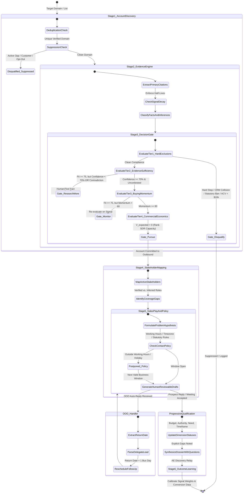

# 🔄 Pillar 3: Application & Cadence Flow (APP_FLOW) — Evidence-Led Account Intelligence & Pipeline Creation Engine

## 1. Master Account Lifecycle State Machine

The engine governs an account from raw domain identification through audited evidence extraction, decision gating, dynamic stakeholder engagement, and progressive qualification:

---

## 2. Multi-Touch Diagnostic Sequence (Testing Hypotheses, Not Spamming)

The engine sequences multi-channel touches to validate or falsify problem hypotheses across key stakeholders:

### Touch 1: Asynchronous Diagnostic Inquiry (Day 1)
- **Channel**: Consultative Email to Champion / Technical Lead
- **Structure**: Pre-computed Situation + latent Problem hypothesis (<75 words).
- **Goal**: Test if the observable operational friction is currently being felt.
- **CTA**: Diagnostic inquiry (*"Is this something your team is currently seeing across clusters, or is it handled?"*).

### Touch 2: Professional Verification & Connection (Day 3)
- **Channel**: LinkedIn
- **Action**: Profile view + short, contextual connection invitation referencing the public telemetry or engineering talk (<200 characters). Zero pitch.

### Touch 3: Real-Time Diagnostic Phone Call (Day 6)
- **Channel**: Telephony / Phone
- **Script**: 15-second pattern interrupt opener linking directly to Touch 1's email hypothesis.
- **Voicemail**: 20-second contextual voicemail indicating an email was sent regarding the specific operational trade-off.

### Touch 4: Asymmetric Technical Value Teardown (Day 12)
- **Channel**: Consultative Email
- **Action**: Share a concise 1-page peer architectural teardown or benchmark.
- **Framing**: *"Put together this 1-page breakdown of how a peer engineering team resolved configuration drift without adding sidecar agents. Thought it might offer helpful perspective."*

### Touch 5: Lateral Multi-Threading to Economic Buyer (Day 18)
- **Channel**: Consultative Email to VP of Infrastructure / CTO
- **Angle**: Connect the Champion’s operational friction to executive business outcomes (audit compliance, cloud margins, deployment velocity).
- **Tone**: Consultative and strategic; references the ongoing dialogue or observation with the technical team.

### Touch 6: Diagnostic Close / Hypothesis Check (Day 26)
- **Channel**: Email to Champion
- **Action**: Check if the timing is inactive or the problem has been solved internally.
- **Copy**: *"Reaching out one last time—it sounds like drift remediation isn't an active priority for this quarter's roadmap. Should we check back ahead of H2 planning?"*

---

## 3. Mandatory Handlers: Empty, Error & Partial Failures

1. **Uncertainty Decision (`Research more`)**:
   - If a company fits the ICP but the technical footprint cannot be confirmed from primary sources, the account is routed to `Research more`. Outreach drafting is blocked until the specific evidence gap is resolved.
2. **Missing Phone Number / No Direct Line**:
   - The engine logs `phone_skipped_unverified` and gracefully continues digital touches without halting the cadence.
3. **Out-of-Office (OOO) Interception**:
   - Next touch is automatically rescheduled to `Return_Date + 1 business day`. If a delegate is named, they are entered into the dynamic stakeholder graph as a provisional contact.
4. **Contact Policy Block (Jurisdiction / Hours / Fatigue)**:
   - If an account has received 2 touches in the past 24 hours, or the recipient is in Germany where cold email is constrained under UWG §7, the engine routes outreach through approved alternate channels (e.g. LinkedIn InMail) or reschedules to the next approved window.

---

## 4. Pre-Call Show-Rate & Executive Bring-Along Protocol

To eliminate the 30% ghosting gap between calendar booking and held meetings, the engine manages pre-call attendance:

1. **T-24h Value Agenda Touch**:
   - Dispatches a 3-point executive value agenda (*"No generic slides; 1. Peer benchmarks on multi-region EKS sync, 2. Egress reduction case study, 3. Tooling Q&A"*).
2. **Executive Bring-Along Prompt**:
   - Generates frictionless invite forwarding copy: *"Since this typically touches cloud margins and SOC 2 audits, Sarah Lin (VP Infrastructure) is welcome to join for the first 10 minutes—I can send her a 1-click calendar invite."*
3. **Ghost Recovery Flow**:
   - If a prospect agrees to talk but fails to pick a time within 48 hours, dispatches a frictionless 2-slot choice (*"Would Thursday at 2 PM or Friday at 10:30 AM work?"*), followed by the Voss walk-away close on Day +5.

---

## 5. Batch Territory Ingestion Flow

1. **Input**: Rep or RevOps provides a CSV of 25–50 accounts (`territory_accounts.csv`).
2. **Batch Processing**:
   - Concurrently verifies domains, executes Tri-Vector scoring, and commits accounts to `Pursue`, `Research more`, `Monitor`, or `Disqualify`.
   - Generates `territory_priority_matrix.json`.
3. **Sequencing Export**:
   - Formulates diagnostic drafts and battlecards, exporting directly to `salesloft_apollo_outreach_export.csv` with localized timezone scheduling windows.
