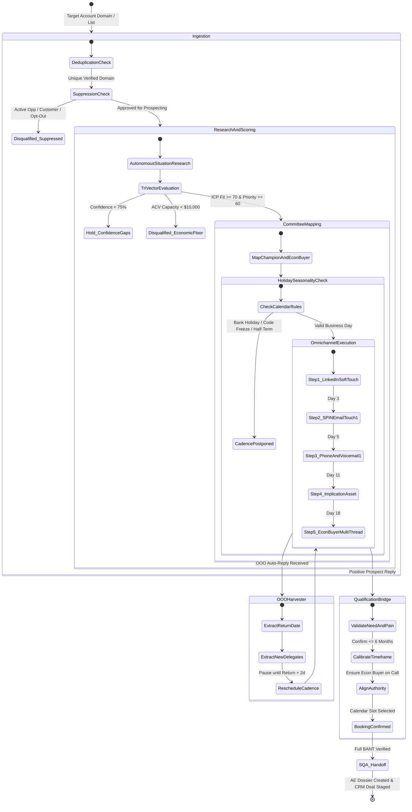

# 🔄 Pillar 3: Application & Cadence Flow (APP_FLOW) — God Mode SaaS ABM SDR

## 1. Master Account Lifecycle State Machine

The God Mode SDR engine governs an account from raw domain identification through BANT-qualified appointment handoff:

---

## 2. The 28-Day Omnichannel Tri-Touch Sequence Steps

The engine executes an integrated sequence balancing persistence with executive space:

### Step 1: Awareness & Soft Signal (Day 1)
- **Channel**: LinkedIn
- **Action**: Profile view of Champion (e.g. Lead SRE / Platform Lead) + like or insightful comment on a recent technical post.
- **Goal**: Plant subconscious brand familiarity before any direct outreach.

### Step 2: Pre-Computed SPIN Email 1 (Day 3)
- **Channel**: Consultative Email
- **Structure**: Pre-computed Situation + latent Problem hypothesis + initial Implication.
- **Constraints**: Strict 75-word ceiling, 5th-grade reading level, mobile-optimized.
- **CTA**: Interest-based inquiry (*"Open to comparing notes?"*).

### Step 3: Cold Call 1 & Pattern Interrupt Voicemail (Day 5)
- **Channel**: Telephony / Phone
- **Action**: 15-second opening hook (*"Alex from Acme Cloud—sent a note on Wednesday regarding cross-zone egress on your EKS clusters..."*).
- **Fallback**: If no answer, drop 20-second Voss voicemail prompting them to check their inbox.

### Step 4: Contextual Connection Request (Day 7)
- **Channel**: LinkedIn
- **Action**: Send connection invitation strictly referencing the specific technical observation (<200 characters). Zero pitch.

### Step 5: Asymmetric Value "Trojan Horse" Asset (Day 11)
- **Channel**: Consultative Email
- **Action**: Deliver an unsolicited, high-value 1-page architecture teardown or peer benchmark.
- **Framing**: *"Put together this 1-page visual on how FinTech X eliminated cluster drift without extra agent daemons. Thought it might help your Q4 review."*

### Step 6: Phone Touch 2 (Day 14)
- **Channel**: Telephony / Phone
- **Script**: Follow up on the specific asset delivered in Step 5.

### Step 7: Multi-Threading to Economic Buyer (Day 18)
- **Channel**: Consultative Email to VP of Infrastructure / CTO
- **Lever**: Connect Champion’s operational focus to high-level executive implications (*"Marcus’s team is evaluating cluster synchronization; at the VP level, this usually impacts roadmap velocity and SOC 2 audits..."*).

### Step 8: Voss "No"-Oriented Close (Day 28)
- **Channel**: Email to both Champion & Economic Buyer
- **Action**: Disarm defense mechanisms.
- **Copy**: *"Have you completely given up on automating multi-cluster policy sync before the Q1 budget cycle?"*

---

## 3. Mandatory Handlers: Empty, Error & Partial Failures

1. **Missing Phone Number / No Telephony Data**:
   - The engine automatically skips the Phone touch, logging `phone_skipped_unverified`, and smoothly advances to the next digital touchpoint without halting the cadence.
2. **Ambiguous Company Identity (Subsidiary vs. Parent)**:
   - Cadence enters `HOLD_IDENTITY_AMBIGUITY` state and generates an alert for human SDR review.
3. **Out of Office (OOO) Interception**:
   - Resets next scheduled touch timestamp to `Return_Date + 2 business days`. If a replacement colleague is named, a new profile node is instantiated in `Account_Ledger.json`.
4. **Tool Disconnection / Mailbox API Failure**:
   - Draft text is safely rendered in the interactive workspace CLI/review terminal, marked `DRAFT_PENDING_MANUAL_COPY`, ensuring no work is lost.
